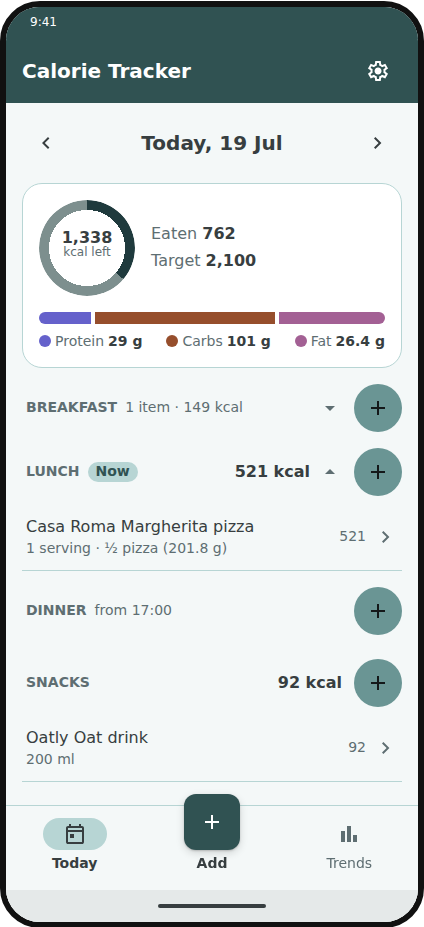
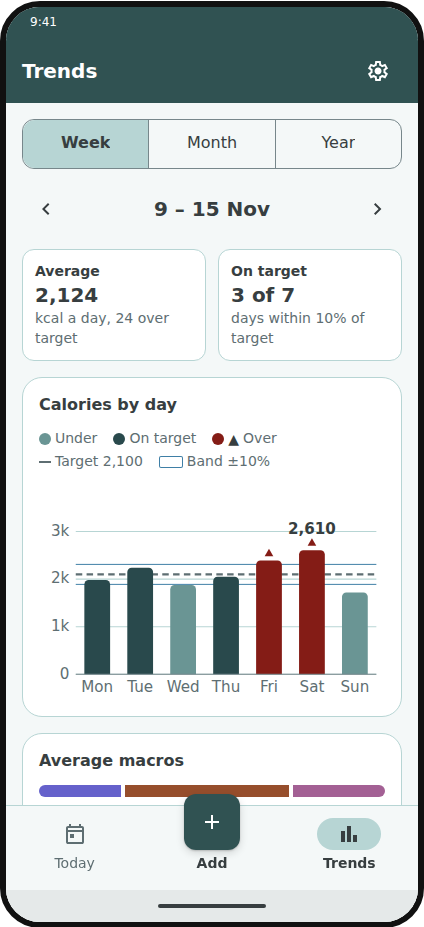
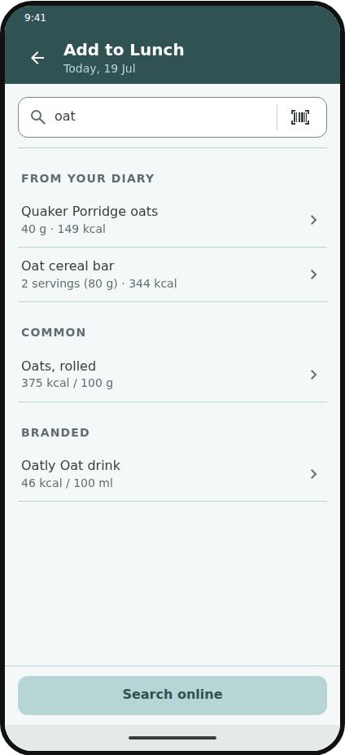
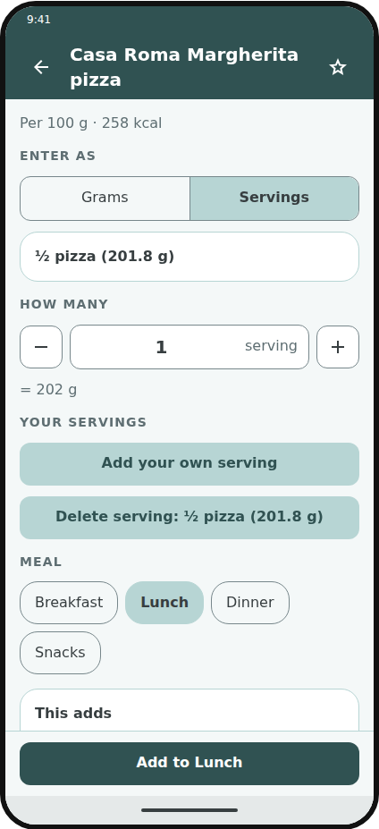

<div align="center">


# Calorie Tracker

**A calorie and meal tracker for Android, built to work offline.**

[](https://github.com/marty-shields/calorie-tracker-app/releases/latest)
-34A853?logo=android&logoColor=white)


[](https://marty-shields.github.io/calorie-tracker-app/)
[](LICENSE)

[What's here](#whats-here) · [Install](#install) · [Built with](#built-with) · [Getting started](#getting-started) · [License](#license)

</div>

---

## What's here

A day diary for Android with a food search, a barcode scanner, trends, a design system, tests and CI. It starts on Today (the Dashboard in the code). The bottom bar has **Today**, a raised **+ Add** button and **Trends**; there are no Foods or Scan tabs. These screens are the main ones:

- **Today**: the day diary, with a date strip, a compact card with calories and macros, and four meals to add food to. On today a meal is open in its time window (breakfast 05:00-11:00, lunch 11:00-15:00, dinner 17:00-21:00, snacks any time; fixed, with no setting) and folds to one line after it; tap it to open it.
- **Add**: the raised + button opens a sheet. Its chips pick the meal (guessed from the time of day), **Search foods** and **Scan barcode** open for that meal and day, and **Usual for <meal>** lists up to three foods you often have there, each added again in one tap at its last amount, with Undo.
- **Trends**: how a week, a month or a year went. It shows the average calories a day, how many days were on target (within 10% of the target that day had, so changing your target never rewrites past days), charts by day, week or month, a calendar, the average macros and meals, and the foods with the most calories. With too little data (under 3 logged days, or for the on-target counts under 3 logged days with a target) a figure says "Not enough data yet" and the layout stays. A day's bar or a calendar day opens that day on Today; a week or month bar opens that week or month in Trends.
- **Foods** (search): type a name to search the bundled food data and the products you scanned. It always adds to a meal, so there is no browse-only list. Results come in groups (your favourites, the foods you logged, then Common, then Branded), best match first; before you type it lists your favourites, the foods you usually have at the meal and the ones you had lately. A food reads as its brand and name, with its pack size and brand line under it. There is no filter by type. **Search online**, a button pinned at the bottom of the screen while you type, looks the typed words up on Open Food Facts too, for your phone's country (worldwide when it has none there); tapping a product stores it the way a scan does. A barcode button next to the box opens the scanner for the same meal.
- **Scan**: read a barcode and add the product to a meal ("Adding to Lunch · 18 Nov"). A scanned product keeps its name, brands, generic name, pack size and extra nutrients. Another size of a product you already have (a 1 L bottle of a drink you scanned as a can) is added to that food, not stored again, when its brand, name (size words ignored), unit and every nutrient agree closely (see [Scan](src/CalorieTracker.UI.Stories/Stories/Screens/Scan.md)); the food then keeps each barcode's pack size.
- **Serving**: set the amount in grams or ml, or a number of servings, and the meal; star the food as a favourite. A food has the servings you add yourself, such as a mug or a bowl, and nothing else; a dropdown picks which one the servings count, and you can add or delete them. A food with none is measured in grams or ml.
- **Settings**: the theme (System, Light or Dark), the daily calorie target and the app version.

<p>
  <picture><source media="(prefers-color-scheme: dark)" srcset="docs/images/readme/today-dark.png"></picture>
  <picture><source media="(prefers-color-scheme: dark)" srcset="docs/images/readme/trends-dark.png"></picture>
</p>

<p>
  <picture><source media="(prefers-color-scheme: dark)" srcset="docs/images/readme/food-search-dark.png"></picture>
  <picture><source media="(prefers-color-scheme: dark)" srcset="docs/images/readme/serving-dark.png"></picture>
</p>

[AGENTS.md](AGENTS.md) lists the rules the code follows, and the [design system](https://marty-shields.github.io/calorie-tracker-app/) shows the tokens, components and screens.

## Install

The app is sideloaded: it isn't on Google Play. Once a release exists:

1. Download `CalorieTracker-X.Y.Z.apk` from the [latest release](https://github.com/marty-shields/calorie-tracker-app/releases/latest).
2. Check it's signed with the release key: `apksigner verify --print-certs CalorieTracker-X.Y.Z.apk` (Android SDK build tools) must show the SHA-256 digest at the top of the release notes.
3. Open it on the phone (allow your file manager to install apps), or run `adb install -r CalorieTracker-X.Y.Z.apk`. A newer version installs over the old one and keeps your data.

Cutting the first release needs the keystore and the `CERT_SHA256` pin: see [Release](docs/release.md).

## Your data

- Data lives in a SQLite database on the phone. Nothing you type (search words, food names, amounts) leaves the phone, except when you tap **Search online** (pinned at the bottom of the screen while you type; or press the keyboard's search key): that sends the words you typed and your phone's country to Open Food Facts (search.openfoodfacts.org), once for each tap (sent again without your country when it has no match) and at most one tap every 2 seconds, and the app says so the first time. Nothing is sent as you type. Scanning a barcode the app hasn't stored sends that barcode to an external product database (Open Food Facts), which returns the product's name, brands, pack size and nutrients; the app also asks for a few fields it uses to rank and date the result and for the unit of a drink's serving (ml or g), and loads no images. A later scan of a stored product may send the barcode again to refresh that food's values, and past diary days follow the refreshed values. The app itself sends none of your food log or other data anywhere. The camera scanner is Google ML Kit, which may send usage metrics to Google as set by Google's terms.
- Your diary, daily target and foods are stored on the phone and in its Android backup (next bullet). A diary entry holds the food id, the amount (g or ml, and the servings and which serving if you entered them), the meal, the day and whether it was removed. The names and sizes of servings you add are stored on the phone too, in the Android backup like the rest. The daily target is one number of calories. Each time you set or clear it the app also keeps a dated row (the day, and the target from then on or none) so Trends can judge a past day against the target it had. Foods are the bundled food data plus the products you scanned and the servings you added, and the foods you starred are kept as favourites; a scanned food keeps each of its barcodes with its pack size and when it was first stored. The theme is kept in the app's web storage, not the database. The app sends none of your diary, daily target or settings anywhere.
- Android Auto Backup copies that database, and only that, to your Google account, and a phone-to-phone transfer carries it too. The Dev build is never backed up.
- Logs are in `Android/data/<package id>/files/logs`, readable over USB or `adb pull`. They hold events, ids, counts and non-personal data such as a scanned barcode, never personal information (no food names, amounts, diary content or search words; [`Logging.feature`](tests/CalorieTracker.E2E.Tests/Features/Logging.feature) checks the start-up lines).

## Built with

| Area | Choice |
|---|---|
| App | [.NET MAUI Blazor Hybrid](https://learn.microsoft.com/dotnet/maui/user-interface/controls/blazorwebview) on .NET 11: Razor components in a native Android shell |
| Platform | Android 16 (API 36), sideloaded |
| Data | SQLite via sqlite-net-pcl, on the device |
| Design system | Design tokens, components and screens, documented in a [BlazingStory](https://github.com/jsakamoto/BlazingStory) stories site, [published on GitHub Pages](https://marty-shields.github.io/calorie-tracker-app/) |
| Tests | NUnit unit tests, bUnit component tests, and end-to-end Gherkin features run by Reqnroll and Appium on a phone or emulator |
| CI | GitHub Actions builds and tests every pull request, end-to-end tests on an emulator included; the release workflow runs them again, then signs and publishes the APK; Dependabot keeps packages current |

### Project layout

```
src/
  CalorieTracker.App/          MAUI Blazor Hybrid host (Android): startup, DI, routing
  CalorieTracker.UI/           Razor class library: screens and food-specific rows; layout-only CSS, every look from the shared kit (Shields.UI)
  CalorieTracker.UI.Stories/   Razor class library: the BlazingStory stories for the UI
  CalorieTracker.UI.Stories.Host/  BlazingStory site that shows them (the kit's shell comes from Shields.UI.Stories)
  CalorieTracker.Core/         Data, schema upgrades, food lookup contracts (Foods), services, logging
tests/
  CalorieTracker.Core.Tests/   NUnit tests for Core
  CalorieTracker.UI.Tests/     bUnit tests for components and screens
  CalorieTracker.E2E.Tests/    Gherkin features on a device (Reqnroll + Appium)
```

## Getting started

You need the .NET 11 SDK with the `maui-android` workload. The full setup, including the Android SDK and the phone, is in [Dev setup & build](docs/dev-setup-build.md).

```powershell
# Build (warnings fail the build)
dotnet build CalorieTracker.slnx

# Run the unit and component tests
dotnet test tests/CalorieTracker.Core.Tests
dotnet test tests/CalorieTracker.UI.Tests

# Browse the stories site at http://localhost:5056 (main is at https://marty-shields.github.io/calorie-tracker-app/)
dotnet run --project src/CalorieTracker.UI.Stories.Host

# Run on a connected Android phone
dotnet build src/CalorieTracker.App -t:Run -f net11.0-android
```

The end-to-end tests need a connected device or an emulator: see [E2E tests](docs/e2e-tests.md).

## License

[MIT](LICENSE).
Third-party notices are in [NOTICE](NOTICE).
